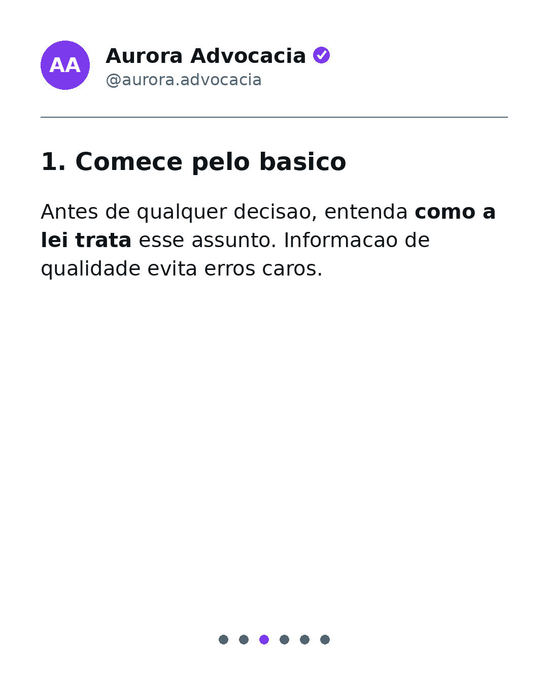
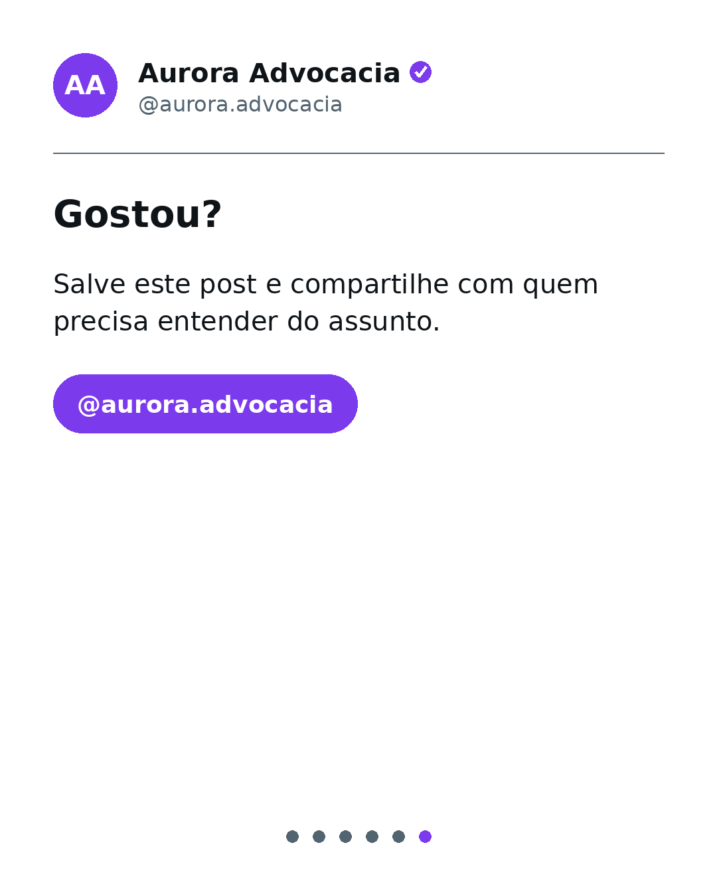

# social-content-studio

Gerador de carrosseis para redes sociais: a partir de um **perfil de marca** (nicho, público, tom, cores) e um **tema**, produz o roteiro dos slides e renderiza os **cards PNG 1080x1350** prontos para postar. Inclui uma **camada de conformidade de conteúdo** com regras configuráveis (exemplo incluso: boas práticas de publicidade na advocacia, inspirado no Provimento OAB 205/2021).

**[English](#english) | [Español](#español)**





## Como funciona

1. **Geração do roteiro** - o tema vira um carrossel (capa, conteúdo, CTA). Dois modos:
   - **offline** (demo e testes): bancos de templates por tom de voz (didático, provocador, institucional). Não precisa de chave nem de rede - é o modo da demo e dos testes;
   - **IA** (opcional, não testada com a API real nesta versão): integração com a API da Anthropic via variável de ambiente `ANTHROPIC_API_KEY`.
   O modo padrão da CLI é `auto`: usa IA se `ANTHROPIC_API_KEY` estiver definida; caso contrário, usa templates offline. Para uma execução sem chamadas pagas, escolha `--mode offline` explicitamente. O modo IA também exige instalar o pacote opcional `anthropic`.
2. **Conformidade** - o roteiro passa por um ruleset em JSON (regex + severidade `error`/`warning`) antes de renderizar. Com `--strict`, qualquer erro bloqueia a geração (exit 2) - pronto para portão de CI.
3. **Renderização** - cada slide vira um card PNG estilo tweet (avatar com iniciais, nome, @handle, selo, **destaques em negrito** e indicador de progresso), com 3 temas (`light`, `dark`, `paper`) e cor da marca customizável. Fontes DejaVu embutidas (licença em `content_studio/fonts/`).

## Uso

```bash
pip install -r requirements.txt

python -m content_studio.cli generate \
  --profile samples/perfil-aurora.json \
  --topic "direitos do trabalhador demitido sem justa causa" \
  --mode offline \
  --out out/
```

Saída: `out/slide-1.png ... slide-N.png` + `out/carousel.json`, e o relatório de conformidade no terminal.

Opções: `--mode offline|ai|auto` · `--theme light|dark|paper` · `--max-slides N` · `--ruleset caminho.json` · `--strict`.

### Docker

```bash
docker build -t social-content-studio .
docker run --rm social-content-studio   # gera um carrossel de exemplo em /app/out
```

### Testes

```bash
pip install -r requirements-dev.txt
pytest        # 21 testes
```

## Limites

As regras de publicidade são exemplos de filtros por expressões regulares. Não cobrem todas as exigências da OAB, não verificam a exatidão jurídica do texto e não substituem revisão humana. Os perfis e os cards da demo são fictícios; o selo é apenas um elemento visual, não uma verificação de identidade.

## Por que este projeto existe

Projeto próprio: um aplicativo de marketing digital e geração de posts para advogados, que criei para vender a escritórios de advocacia. Não é um projeto desenvolvido para o escritório. Esta versão pública e genérica apresenta o motor de geração de conteúdo, renderização de cards e filtros de publicidade, com dados fictícios.

## Estrutura

```
content_studio/
  generator.py    # roteiro: templates offline + modo IA opcional
  compliance.py   # regras configuráveis aplicadas ao roteiro
  renderer.py     # cards PNG 1080x1350 estilo tweet (Pillow)
  carousel.py     # orquestração do fluxo completo
  cli.py          # interface de linha de comando
  rules/          # ruleset de exemplo (publicidade na advocacia)
  fonts/          # fontes DejaVu + licença
samples/          # perfis fictícios + carrossel de exemplo gerado
tests/            # 21 testes pytest
```

## Stack

Python · Pillow · pytest · Docker · GitHub Actions

---

## English

Carousel generator for social media: from a **brand profile** (niche, audience, tone, colors) and a **topic**, it produces the slide script and renders **1080x1350 PNG cards** ready to post. Includes a **content compliance layer** with configurable rules (sample ruleset included: advertising best practices for law firms, inspired by Brazilian Bar rules).

- **Script generation**: offline templates for the demo and tests, or optional AI mode via Anthropic API (`ANTHROPIC_API_KEY`, optional `anthropic` package required). The CLI defaults to `auto`: AI when a key is set, offline otherwise. Choose `--mode offline` to avoid paid API calls. The AI integration has not been tested against the live API in this version.
- **Compliance**: the script is checked against a JSON ruleset (regex + `error`/`warning` severity) before rendering. `--strict` blocks generation on errors (exit 2) - ready for CI gating.
- **Rendering**: tweet-style PNG cards (initials avatar, name, @handle, badge, **bold highlights**, progress dots), 3 themes plus custom brand color. DejaVu fonts bundled.

**Quick start**: `pip install -r requirements.txt`, then `python -m content_studio.cli generate --profile samples/perfil-aurora.json --topic "your topic" --mode offline --out out/`. Docker and tests as shown above. 21 pytest tests.

**Limits**: sample regex filters do not guarantee compliance with Bar rules or legal accuracy. Human review is required. Demo brands are fictional; the badge is decorative, not identity verification.

**Background**: my own project: a digital marketing and post-generation app for lawyers, which I created to sell to law firms. It is not a project built for the law office. This public, generic version presents the content-generation engine, card rendering and advertising filters, using fictional data.

---

## Español

Generador de carruseles para redes sociales: a partir de un **perfil de marca** (nicho, público, tono, colores) y un **tema**, produce el guion de las diapositivas y renderiza las **tarjetas PNG 1080x1350** listas para publicar. Incluye una **capa de cumplimiento de contenido** con reglas configurables (ejemplo incluido: buenas prácticas de publicidad para bufetes de abogados, inspirado en las normas del Colegio de Abogados de Brasil).

- **Generación del guion**: plantillas offline para la demo y los tests, o IA opcional vía API de Anthropic (`ANTHROPIC_API_KEY`, requiere el paquete opcional `anthropic`). La CLI usa `auto` por defecto: IA si hay una clave, offline en caso contrario. Usa `--mode offline` para evitar llamadas de pago. La integración de IA no se ha probado con la API real en esta versión.
- **Cumplimiento**: el guion se valida contra un ruleset JSON (regex + severidad `error`/`warning`) antes de renderizar. `--strict` bloquea la generación ante errores (exit 2) - listo para CI.
- **Renderizado**: tarjetas PNG estilo tweet (avatar con iniciales, nombre, @handle, insignia, **destacados en negrita**, indicador de progreso), 3 temas y color de marca personalizable. Fuentes DejaVu incluidas.

**Inicio rápido**: `pip install -r requirements.txt`, luego `python -m content_studio.cli generate --profile samples/perfil-aurora.json --topic "tu tema" --mode offline --out out/`. Docker y tests como se indica arriba. 21 tests con pytest.

**Límites**: los filtros regex de ejemplo no garantizan el cumplimiento de las normas profesionales ni la exactitud jurídica. Se requiere revisión humana. Las marcas de la demo son ficticias; la insignia es decorativa, no una verificación de identidad.

**Contexto**: proyecto propio: una aplicación de marketing digital y generación de publicaciones para abogados, que creé para vender a despachos de abogados. No es un proyecto desarrollado para el despacho. Esta versión pública y genérica presenta el motor de generación de contenido, el renderizado de tarjetas y los filtros de publicidad, con datos ficticios.
